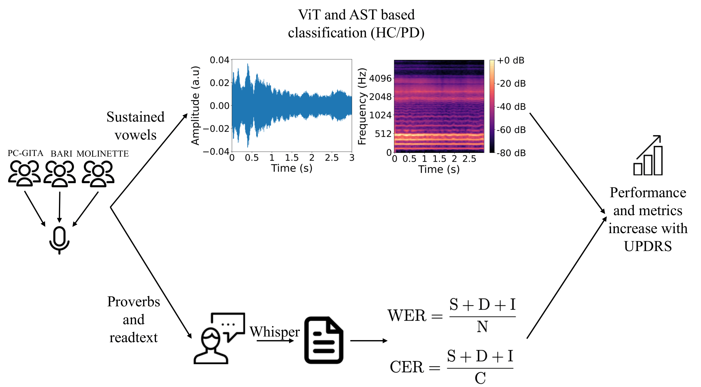

# Benedetta Perrone — portfolio

Sito personale statico: HTML, CSS e un file JavaScript. Nessuna build, nessuna
dipendenza da installare. Si pubblica su GitHub Pages così com'è.

---

## Come vedere il sito

**In locale**: doppio clic su `index.html`. Si apre nel browser e funziona tutto,
compreso il menu mobile (i percorsi sono tutti relativi).

Se vuoi un server locale (utile solo per testare i social preview):

```bash
python -m http.server 8000
# poi apri http://localhost:8000
```

**Online**: GitHub Pages, da *Settings → Pages → Source: main branch, / (root)*.

---

## Struttura

| File | Cosa contiene |
|---|---|
| `index.html` | Home: hero, About me, Publications, Projects, Background, Beyond, Contact |
| `publications.html` | Elenco completo di articoli e tesi |
| `cv.html` | Pagina **Background**: Education ed Experience richiudibili, Leadership, Honours, Skills, Languages + download PDF |
| `beyond.html` | Music, Outreach, Photos |
| `styles.css` | Tutti gli stili, condivisi dalle quattro pagine |
| `site.js` | Menu mobile e anno nel footer |
| `images/` | Foto |
| `cv/` | `CV_BenedettaPerrone.pdf` |

### A cosa serve `site.js`

Trentacinque righe, due cose:

1. **Menu mobile.** Sotto i 960px il menu diventa un pannello a tendina. Il JS
   apre e chiude il pannello al clic sull'hamburger, aggiorna `aria-expanded`
   per gli screen reader, chiude il pannello dopo aver toccato un link e lo
   chiude con il tasto Esc.
2. **Anno nel footer.** Scrive l'anno corrente, così il copyright non invecchia.

Il sito resta leggibile e navigabile anche con JavaScript disattivato: si perde
solo l'apertura del menu su mobile.

---

## Navigazione

Quattro voci, tutte pagine:

```
Benedetta Perrone      HOME  PUBLICATIONS  BACKGROUND  BEYOND  │  icone social
```

Tutte le voci puntano a pagine intere: nessuna ancora, così non c'è ambiguità
fra "ti sposto di pagina" e "ti faccio scorrere". La voce attiva è sottolineata
in verde tramite la classe `.on`. Anche il nome in alto a sinistra porta alla
home.

La pagina si chiama `cv.html` sul disco, ma nel menu si chiama **Background**:
"CV" è riservato al PDF scaricabile.

---

## Design

- **Colori**: carta calda `#faf8f3`, verde bosco `#1f5c46`, verde profondo
  `#0e3b2e`, salvia `#8ea08e`. Tutti in variabili CSS in cima a `styles.css`,
  quindi si cambia la palette in un punto solo.
- **Font**: [Fraunces](https://fonts.google.com/specimen/Fraunces) per i titoli,
  [Inter](https://fonts.google.com/specimen/Inter) per il testo. Caricati da
  Google Fonts.
- **Titoli di sezione senza punto finale.**
- **Blocco contatti compatto**: email e indirizzo su una riga sola, ciascuno con
  la propria icona (busta e segnaposto), senza il titolone della mail.
- **Niente trattini lunghi nei testi discorsivi**: restano solo come separatore
  tipografico nelle intestazioni (`Politecnico di Torino — M.Sc. ...`).

### Responsive

Verificato senza overflow orizzontale su tutte e quattro le pagine a 320, 375,
768, 1024 e 1440px.

- sotto **960px**: hero, sezioni e griglie passano a colonna singola, il menu
  diventa a tendina;
- sotto **560px**: la galleria fotografica va a una colonna;
- sotto **400px**: le icone social spariscono dall'header, perché non ci stanno
  insieme a nome e hamburger. Restano nell'hero della home.

---

## Cosa manca

Cerca `TODO` nei file HTML: i punti da riempire sono marcati lì.

### Immagini da aggiungere in `images/`

| File | Dove va |
|---|---|
| `pub-parkinson.png` | figura del paper Parkinson, in `index.html` e `publications.html` |
| `pub-sleep.png` | figura del paper sonno, in `index.html` e `publications.html` |
| `outreach-1.jpg` `outreach-2.jpg` `outreach-3.jpg` | galleria Outreach in `beyond.html` |
| `city-turin.jpg` `city-dublin.jpg` `city-leuven.jpg` | galleria Photos in `beyond.html` |

Finché mancano, al loro posto c'è un riquadro tratteggiato che indica il nome
del file atteso. Per inserirne una, sostituisci il blocco:

```html
<div class="pfig"><div class="slot"><span>Figure 1<br>...</span></div></div>
```

con:

```html
<div class="pfig"></div>
```

e scrivi la didascalia in `<p class="figcap">`.

> **Copyright delle figure.** *Algorithms* (MDPI) è CC-BY: la figura si può
> ripubblicare citando la fonte. *Biomedical Signal Processing and Control*
> (Elsevier) non lo è, salvo open access pagato. In quel caso usa la versione
> author-accepted o rigenera il grafico dai tuoi dati.

### Testi da scrivere

- **Music** in `beyond.html`: al momento è un segnaposto dichiarato.
- **Didascalie** delle figure e delle foto.

### Link mancanti

- **ORCID.** Nella prima versione avevo messo l'icona ORCID accanto a Scholar,
  LinkedIn, GitHub ed email, ma non avendo il tuo identificativo l'unica
  alternativa era un link finto, quindi l'ho tolta. Le icone attualmente
  presenti sono quattro: **Google Scholar, LinkedIn, GitHub, email**. Per
  rimettere ORCID serve l'URL nella forma `https://orcid.org/0000-0000-0000-0000`,
  da aggiungere in tutti e quattro i file HTML (blocco `.socials` nell'header,
  più `.herosoc` in `index.html`) e nell'array `sameAs` del JSON-LD.
- **PDF della tesi magistrale** in `publications.html`, se vuoi linkarlo.

---

## Note

- Il **tema scuro** della versione precedente non c'è più: la palette carta
  calda non ha un equivalente scuro immediato e andrebbe progettata a parte.
- I dati strutturati **JSON-LD** in `index.html` (schema.org `Person`) aiutano
  Google a capire chi sei: vanno tenuti allineati se cambi affiliazione o
  profili.
